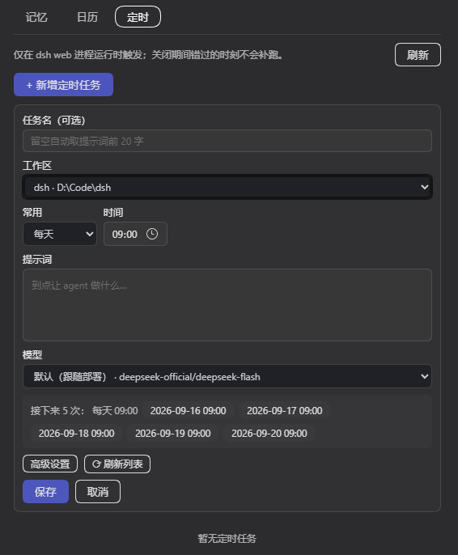

# dsh-lite-memory — DSH 简化版记忆插件

参考 [dsh-auto-memory](https://github.com/Aik358/dsh-auto-memory) 裁剪的轻量记忆插件：

- **条目化记忆**（SQLite `~/.dsh/memory/memory.db`）：每条记忆含标题 / 内容 / 重要程度（高·中·低）/ 来源（工作区-会话）/ 创建更新时间，按条目增删改查
- **记忆工具**：`memory_recall`（关键词检索条目）/ `memory_entry`（条目增删改查）
- **日历与提醒**：`calendar_add` / `calendar_list` / `calendar_done` / `calendar_remove`；到点后通过 `agent.followup` 把提醒投递到注册会话（会话被移除则新建会话投递）
- **定时任务**：cron 表达式（5 字段「分 时 日 月 周」）驱动的**进程内调度**——到点由 DSH 拉起会话执行提示词，执行记录落库
  - 工具：`cron_add` / `cron_list` / `cron_run`（立即运行）/ `cron_toggle` / `cron_remove`
  - 面板：任务列表（状态点 · 表达式 · 人话描述 · 下次运行 · 启停）+ 详情表单 + **表达式实时预览未来 5 次** + 执行记录，支持手动新增 / 编辑 / 删除 / 立即运行
  - 表单尽量少填：**工作区**与**模型**都是下拉选择（工作区来自 `workspaceRegistry` 的真实目录，模型来自 `llm` 的 provider/模型目录；选中某个模型后再按它真正支持的推理强度给下拉），任务名可留空自动取提示词前 20 字；表达式原文、超时、preset、触发落点收进「高级设置」
  - 触发落点可选「新建会话」（缺省，跑完即卸载、会话日志保留）或「投递到指定会话」（活着直接投递，否则在原会话上续跑）
  - **任务级模型路由**：`provider` / `model` / `reasoningEffort` + `preset` + `cwd`。路由**只对「新建会话」生效**，投递型沿用目标会话自身的模型；留空则用部署默认模型（`agentDefaultModel`），不会出现「没模型就跑」的情况
  - 同一分钟内最多触发一次；同任务不重入、全局并发上限 2、单次超时缺省 600 秒（超时取消并记为 `timeout`）
- **对话面板「记忆」tab**：条目化记忆面板（卡片列表 + 新增/编辑/删除，重要程度色标、来源角标）
- **设置页「记忆」分区**：二级菜单（记忆 / 日历 / 定时）——日历为月视图 + 当天 07:00-22:00 时间轴 + 浮层编辑，面板下方「待执行」「已完成」双 tab 纵向列表
- **中英双语**：跟随 DSH 设置的语言，无手动外观设置、默认字号

## 界面预览

设置 → 记忆 → 定时。工作区与模型都是下拉；推理强度在选中具体模型后才出现；表达式原文、超时、preset、触发落点收进「高级设置」。



## 兼容性 / 支持的 DSH 版本

- **本版实测**：DSH `0.2.2-rc.1`（桌面版；Node `24.21`）
- **上一版实测**：DSH `0.1.5-rc.1`（`0.4.1` 及更早）
- **声明范围**：`engines.dsh: ">=0.2.2-rc.1"` —— 插件市场（dshmarket）按 package.json 的 `engines.dsh`（或 `dsh.engines.dsh`）判定宿主兼容性；未声明显示「未声明」，不满足则拒绝安装
- **为什么改声明**：按 node-semver 的预发布规则，`0.2.2-rc.1` **不满足** 旧声明 `>=0.1.5-rc.1`（预发布版本只有比较器同为 `主.次.补` 且带预发布标签时才被纳入），旧声明在当前桌面包上会被市场判为不兼容
- **Node**：`>=22.5.0`（用到 `node:sqlite`；22.5–23.3 需 `--experimental-sqlite`，24 起默认可用）
- **用到的宿主能力**（据此可自行判断其他 DSH 版本是否可用）：
  - `agents.create` / `resume({ resumeSessionId })` / `get` / `followup({ content, source })`、`handle.dispose()`、`agent.cancel({ kind, reason })`
  - 事件 `agent/status`、`agent/error`、`session/event(session, event)`（`turn/start`、`turn/end`、`assistant/message`）
  - `timer.interval`、`webServer.register`、`systemPrompt.context({ name, order, text })`、`tools.register`
  - 面板下拉数据源：`workspaceRegistry.list`、`llm.listProviders` / `listModels` / `resolveModelInfo`、`agentDefaultModel.currentSelection`、`agentPresets.resolve`
  - 上述可选服务缺失时都能降级（下拉退回手填），但缺 `agentDefaultModel` 会让新建会话的 prompt 装配失败
- **0.5.0 针对 0.2.x 修的两处宿主契约**：
  1. 工具注册不再 `createRequire` + `import()` 解析 `@deepseek-ai/dsh-tools`（桌面版把它打进 `app.asar`，且 `agentPresets.list()` 已不再返回 `path`，旧侦测直接落空导致 13 个工具静默不注册）。改为自带等价 `defineTool`（`lib/define-tool.js`）：属性级 `required` 编译成 JSON Schema、执行前预校验；同时避免从 profile `node_modules` 解析到镜像副本污染整个 base 层。
  2. 投递消息改用 v4 会话格式的 producer-owned source：`{ kind: 'dsh-lite-memory', form, summary }`；旧的 `{ kind: 'plugin', plugin: … }` 会被 `format v4 message requires a producer-owned source kind` 拒绝（日历提醒与定时任务都受影响）。

## 定时任务的触发边界

调度器跑在 `dsh web` 进程内，**没有守护进程，不读写系统 crontab**：

- 只在 `dsh web` 运行期间触发；进程关闭时错过的时刻**不会补跑**（错过即丢）
- 每次触发会新建一个会话（`cwd` 缺省为 dsh web 进程的工作目录），跑完即从内存卸载，会话日志保留可回看
- 每次触发是一轮真实的 agent 会话，会消耗 token；请给任务设置合理的超时
- 成本与权限控制：用**任务级模型路由**（provider / model / effort）选便宜的模型，用 **preset** 限定工具集与人格
- 无人值守执行：请在任务里指定 preset 并确认其审批策略与工具限制，否则任务可能卡在审批上

## 安装

在插件市场（设置 → 插件市场，dshmarket）里搜 `dsh-lite-memory` 一键安装，或按市场条目用命令行安装：

```bash
dsh plugin --profile web add github:SiriusWJ/dsh-lite-memory
```

安装后重启 dsh web 生效。

> npm 上的 `dsh-lite-memory` 是另一位作者的实现（regrevia），与本插件无关。
> 本插件经 **GitHub 源**分发（市场条目 `install: dsh plugin … add github:SiriusWJ/dsh-lite-memory`），
> 不要 `npm i dsh-lite-memory`。

## 存储

| 数据 | 位置 |
|---|---|
| 记忆条目 | `~/.dsh/memory/memory.db`（表 `entries`） |
| 日历事项 | `~/.dsh/memory/memory.db`（表 `calendar`） |
| 定时任务 | `~/.dsh/memory/memory.db`（表 `cron_jobs`） |
| 定时任务执行记录 | `~/.dsh/memory/memory.db`（表 `cron_runs`，滚动保留最近 500 条） |

旧版 `MEMORY.md` / `calendar.json` 数据不再读写。

## License

BSD-3-Clause
